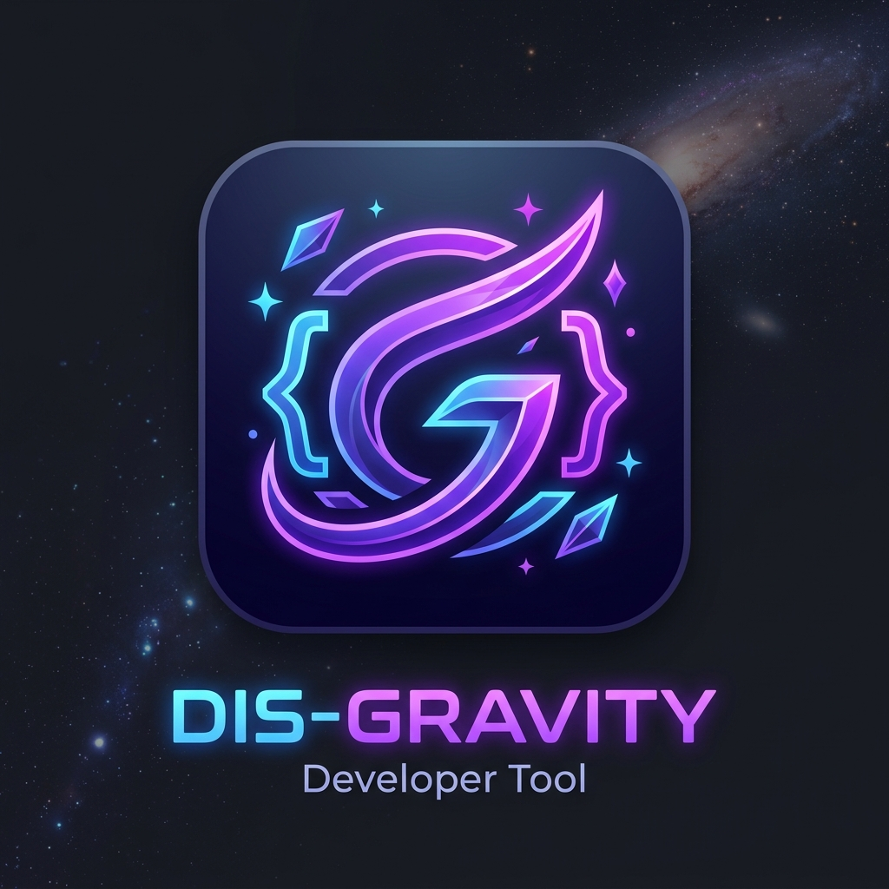
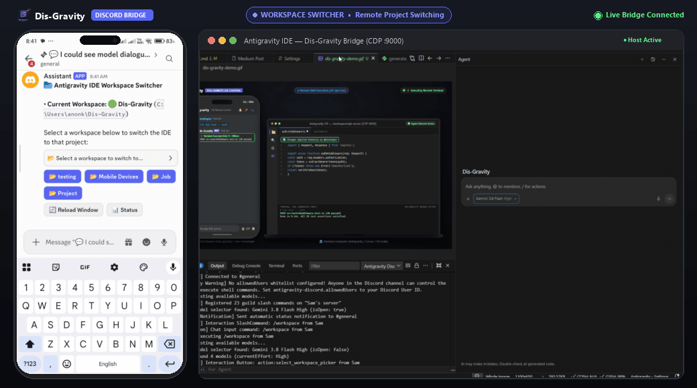

<p align="center">
  
</p>

<h1 align="center">Dis-Gravity</h1>

<p align="center">
  <strong>The Ultimate Multi-IDE Discord Remote Bridge & AI Coding Interface</strong>
</p>

<p align="center">
  <a href="#supported-ides--environments"></a>
  <a href="https://www.npmjs.com/package/dis-gravity"></a>
  <a href="#installation"></a>
  <a href="LICENSE.txt"></a>
  <a href="https://discord.com"></a>
</p>

---

> **Control your IDE, AI assistant, shell, and git repo directly from Discord on mobile, tablet, or secondary machines.**
> Send prompts, approve tool executions, inspect real-time streaming steps, run terminal commands, view colored git diffs, download artifacts, and receive retina-crisp visual PNG table cards anywhere you go.

---

<p align="center">
  
</p>

---

## 📑 Table of Contents

- [Supported IDEs & Environments](#supported-ides--environments)
- [📦 Installation](#-installation)
  - [Option 1: Instant via npx (Zero Install)](#option-1-instant-via-npx-zero-install)
  - [Option 2: Install Global CLI via npm](#option-2-install-global-cli-via-npm)
  - [Option 3: Install VS Code / Antigravity Extension (.vsix)](#option-3-install-vs-code--antigravity-extension-vsix)
  - [Option 4: Build .vsix from Source](#option-4-build-vsix-from-source)
- [🚀 3-Minute Quickstart Guide](#-3-minute-quickstart-guide)
  - [Step 1: Create Your Discord Bot](#step-1-create-your-discord-bot)
  - [Step 2: Invite the Bot to Your Server](#step-2-invite-the-bot-to-your-server)
  - [Step 3: Retrieve Channel ID & User ID](#step-3-retrieve-channel-id--user-id)
  - [Step 4: Configure Dis-Gravity in Your IDE](#step-4-configure-dis-gravity-in-your-ide)
- [Connecting Your Specific IDE](#connecting-your-specific-ide)
  - [1. Visual Studio Code & GitHub Copilot (Zero Port Required)](#1-visual-studio-code--github-copilot-zero-port-required)
  - [2. Google Antigravity, Cursor AI & Windsurf (Port 9000)](#2-google-antigravity-cursor-ai--windsurf-port-9000)
  - [3. JetBrains, Neovim & Headless Servers (Standalone CLI Daemon)](#3-jetbrains-neovim--headless-servers-standalone-cli-daemon)
- [🛡️ Security Best Practices (`allowedUsers`)](#️-security-best-practices-allowedusers)
- [🌟 Key Features](#-key-features)
- [⌨️ Slash Commands & Text Shortcuts](#️-slash-commands--text-shortcuts)
- [⚙️ Configuration Reference](#️-configuration-reference)
- [❓ Troubleshooting & FAQ](#-troubleshooting--faq)
- [📄 License](#-license)

---

## Supported IDEs & Environments

| IDE / Environment | Provider Mode (`agentProvider`) | Connection Type | Autonomous Tools |
|---|---|---|---|
| **Google Antigravity** | `antigravity` or `auto` | CDP (`:9000`) | Native IDE Agent + Approval Dialogs + Lexical Mode Chips |
| **VS Code + GitHub Copilot** | `copilot` or `auto` | Native `vscode.lm` | Autonomous ReAct Loop (`view`, `edit`, `sh`, `git`, `tree`) |
| **Cursor AI** | `cursor` or `auto` | CDP (`:9000`) | Composer & Chat (`/plan`, `/edit`, `@Codebase`) |
| **Windsurf** | `windsurf` or `auto` | CDP (`:9000`) | Cascade Chat Webview with deep iframe traversal |
| **JetBrains / Neovim / Headless** | `cli` (`bin/dis-gravity.js`) | Subprocess / PTY | Universal CLI (`agy`, `claude`, `aider`, `shell`) |

---

## 📦 Installation

Choose the setup that best fits your workflow:

### Option 1: Instant via npx (Zero Install)
Run the standalone Dis-Gravity CLI daemon directly from npm without installing:

```bash
npx dis-gravity --token="YOUR_BOT_TOKEN" --channel="YOUR_CHANNEL_ID" --provider="cli"
```

### Option 2: Install Global CLI via npm
Install the `dis-gravity` command globally on your machine:

```bash
npm install -g dis-gravity
dis-gravity --help
```

### Option 3: Install VS Code / Antigravity Extension (.vsix)
1. Download `dis-gravity-1.1.0.vsix` from [GitHub Releases](https://github.com/sambath-rethinakumar/Dis-Gravity/releases) or the root of this repository.
2. In VS Code or Google Antigravity IDE:
   - Press `Ctrl+Shift+P` (or `Cmd+Shift+P` on macOS).
   - Type **Extensions: Install from VSIX...** and select `dis-gravity-1.1.0.vsix`.

### Option 4: Build .vsix from Source
```bash
git clone https://github.com/sambath-rethinakumar/Dis-Gravity.git
cd Dis-Gravity
npm install
npx @vscode/vsce package --no-dependencies
```
*(The production extension and CLI bundles are pre-compiled and self-contained; packaging produces `dis-gravity-1.1.0.vsix` immediately).*

---

## 🚀 3-Minute Quickstart Guide

### Step 1: Create Your Discord Bot

1. Open the **[Discord Developer Portal](https://discord.com/developers/applications)** and sign in.
2. Click **New Application** (top right), enter `Dis-Gravity` (or your preferred name), and click **Create**.
3. In the left navigation, select **Bot**:
   - Under **Build-A-Bot**, click **Reset Token** and copy the **Bot Token** (keep this secret!).
4. Scroll down to **Privileged Gateway Intents**:
   > [!IMPORTANT]
   > You **MUST** turn ON the following intents, otherwise Discord will silently drop message text and your bot will fail to process chat commands:
   - ✅ **MESSAGE CONTENT INTENT** *(Required to read messages and slash prompts)*
   - ✅ **SERVER MEMBERS INTENT** *(Recommended for user whitelist lookups)*
5. Click **Save Changes**.

---

### Step 2: Invite the Bot to Your Server

1. In the left navigation, go to **OAuth2** → **OAuth2 URL Generator**.
2. Under **Scopes**, select:
   - ✅ `bot`
   - ✅ `applications.commands` *(Required for native slash commands `/`)*
3. Under **Bot Permissions**, select:
   - ✅ `Send Messages`
   - ✅ `Create Public Threads`
   - ✅ `Send Messages in Threads`
   - ✅ `Embed Links`
   - ✅ `Attach Files`
   - ✅ `Read Message History`
   - ✅ `Use Slash Commands`
4. Copy the generated **OAuth2 URL** at the bottom, paste it into your browser, choose your server, and click **Authorize**.

---

### Step 3: Retrieve Channel ID & User ID

1. In Discord, go to **User Settings** (⚙️ bottom left) → **Advanced** → turn **ON** **Developer Mode**.
2. Right-click the channel where you want Dis-Gravity to chat → click **Copy Channel ID**.
3. Right-click your own avatar/profile in the chat → click **Copy User ID** (used for security access control).

---

### Step 4: Configure Dis-Gravity in Your IDE

1. Open VS Code or Antigravity IDE with the Dis-Gravity extension installed.
2. Click the **Discord** icon in the Activity Bar (left sidebar) to open Dis-Gravity settings.
3. Fill in the fields:
   - **Bot Token**: Paste the token from Step 1.
   - **Channel ID**: Paste the Channel ID from Step 3.
   - **Allowed Users**: Paste your Discord User ID from Step 3.
   - **Agent Provider**: Choose `auto` (or `copilot`, `antigravity`, `cursor`, `windsurf`, `cli`).
4. Click **Save Settings** or reload your window (`Developer: Reload Window`). Both status dots will turn green:
   - 🟢 **Discord: Connected**
   - 🟢 **CDP / Agent: Connected**

---

## Connecting Your Specific IDE

### 1. Visual Studio Code & GitHub Copilot (Zero Port Required)

If you are using standard Visual Studio Code with GitHub Copilot Chat:
1. In settings, set `antigravity-discord.agentProvider` to `"copilot"`.
2. **Zero debug port is needed!** Dis-Gravity communicates directly via VS Code's native Language Model API (`vscode.lm`).
3. Dis-Gravity automatically activates an **autonomous ReAct tool loop** supporting `view_file`, `edit_file`, `run_command`, and `git_diff` with live step streaming and Discord confirmation buttons (`[ 🟢 Allow ]`, `[ 🔴 Deny ]`) for sensitive changes.

---

### 2. Google Antigravity, Cursor AI & Windsurf (Port 9000)

These IDEs drive agent chat via Chrome DevTools Protocol (CDP) and require launching the application with `--remote-debugging-port=9000`.

#### **Windows**
1. Right-click your desktop shortcut for Antigravity / Cursor / Windsurf → select **Properties**.
2. In the **Target** box, append ` --remote-debugging-port=9000` to the end of the path:
   ```text
   "C:\Users\...\AppData\Local\Programs\Antigravity\Antigravity.exe" --remote-debugging-port=9000
   ```
3. Click **Apply** and launch the IDE from this shortcut.

#### **macOS**
Launch via Terminal or save a shell script / Automator app:
```bash
# Google Antigravity
open -a "Google Antigravity" --args --remote-debugging-port=9000

# Cursor
open -a "Cursor" --args --remote-debugging-port=9000

# Windsurf
open -a "Windsurf" --args --remote-debugging-port=9000
```

#### **Linux**
```bash
antigravity --remote-debugging-port=9000
# or cursor --remote-debugging-port=9000
```

---

### 3. JetBrains, Neovim & Headless Servers (Standalone CLI Daemon)

Dis-Gravity includes a standalone, editor-agnostic daemon that runs in any terminal or remote SSH session:

```bash
# Run instantly with npx:
npx dis-gravity --token="YOUR_BOT_TOKEN" --channel="CHANNEL_ID" --workspace="." --allowed-users="YOUR_USER_ID"

# Or run globally via npm:
npm install -g dis-gravity
dis-gravity --token="YOUR_BOT_TOKEN" --channel="CHANNEL_ID" --provider="cli"
```

**CLI Daemon Flags:**
- `--token`, `-t`: Discord Bot Token (or `DISCORD_BOT_TOKEN` env var)
- `--channel`, `-c`: Discord Channel ID (or `DISCORD_CHANNEL_ID` env var)
- `--guild`, `-g`: Discord Guild ID for instant slash command registration
- `--allowed-users`, `-u`: Comma-separated Discord User IDs allowed to issue commands
- `--provider`, `-p`: AI engine (`cli`, `antigravity`, `cursor`, `windsurf`)
- `--workspace`, `-w`: Path to root workspace directory (defaults to current working directory)
- `--table-style`: Tabular style (`image`, `cards`, `rounded`, `boxed`, `ascii`)
- `--port`: Remote debugging CDP port (defaults to `9000`)

---

## 🛡️ Security Best Practices (`allowedUsers`)

> [!CAUTION]
> **Never connect Dis-Gravity to a public or multi-user Discord channel without configuring `allowedUsers`!**

Dis-Gravity enforces **default-deny authorization**: all remote commands (`/sh`), file inspections (`/cat`), and interactions are automatically blocked by default until at least one authorized Discord User ID is added to `allowedUsers`.

1. **Always configure `allowedUsers`**: Enter your Discord User ID (e.g. `123456789012345678`). Multiple authorized users can be separated by commas (`123456789,987654321`). Unauthorized users and unconfigured environments receive an explicit rejection notice.
2. **Use a Private Channel**: Dedicate a private Discord text channel accessible only to you and the bot.
3. **Interactive Approvals**: File modifications and terminal executions in Copilot / CLI modes prompt you with interactive `[ 🟢 Allow ]` and `[ 🔴 Deny ]` buttons before changes take effect.

---

## 🌟 Key Features

### 🖼️ High-Resolution Visual Table Image Cards (`/table`, `!table`)
Discord mobile apps suffer from a notorious line-wrapping bug that scrambles monospaced ASCII tables into unreadable text blocks. Dis-Gravity dynamically converts Markdown tables into **high-resolution 2x retina PNG cards** rendered natively in Discord messages, complete with dark theme styling, zebra rows, bold headers, colored status chips (`#57f287` green, `#fee75c` yellow, `#ed4245` red), full-color emojis, and pinch-to-zoom support. Features headless browser fallback (`msedge`/`chrome`) for environments without CDP ports.

### 🎮 1-Click Command Palette (`/palette`, `/action`)
Execute any of VS Code's 1,000+ commands remotely from your phone with 1 tap. Pre-built buttons across Developer (Reload Window, Restart Extension Host), Terminal (New, Toggle, Kill), Files (Save All, Close All), and Git (Sync, Pull, Push), plus live autocomplete search for any IDE command.

### 💻 Remote Shell & Git Suite (`/sh`, `/git`, `/diff`)
Execute terminal commands in your workspace root (`/sh npm test`), inspect syntax-highlighted stdout/stderr with exit codes and execution duration, review git status (`/git status`), browse colored unified diffs (`/diff`), stage all changes, and export `.patch` files.

### 📁 Remote File Explorer & Slicer (`/cat`, `/tree`, `/open`)
Read files with syntax highlighting and line numbers (`/cat src/index.js 1 50`), inspect visual directory trees (`/tree src 2`), or open files directly in your desktop IDE editor tabs remotely (`/open README.md`).

### 📦 Artifact Discovery & Download (`/artifact`, `/get`)
Browse and download AI-generated walkthroughs, architectural plans, patch files, diagrams, or workspace assets directly in Discord with interactive dropdown menus and path-traversal security protection.

### ⏳ Live Step Streaming & Observability
Replaces static wait timers with real-time DOM step updates: `⏳ Working (18s): 🔍 Viewing file package.json`, `⚡ Running command npm test`, `💭 Thinking...`.

### 🖥️ Host Health & Workspace Dashboard (`/info`, `/workspace`)
Check active workspace, git branch, dirty file count, open editor tabs, host OS, CPU load, memory utilization, and uptime directly from chat.

---

## ⌨️ Slash Commands & Text Shortcuts

| Command | Chat Shortcut | Description |
|---|---|---|
| `/plan <prompt>` | `!plan <prompt>` | Activates Planning Mode with native IDE chip |
| `/goal <prompt>` | `!goal <prompt>` | Activates Goal Mode with autonomous execution instructions |
| `/grill <prompt>` | `!grill <prompt>` | Activates Alignment Interview mode |
| `/sh <cmd>` | `!sh <cmd>` or `$ <cmd>` | Execute shell command in workspace root |
| `/git [status\|diff\|log]` | `!git [subcommand]` | Remote Git repository management |
| `/diff [file] [staged]` | `!diff` | Colored git diff inspector with 1-tap Stage/Push |
| `/cat <path> [start] [end]` | `!cat <path>` | Read file contents with syntax highlighting |
| `/tree [dir] [depth]` | `!tree` | Visual workspace directory tree |
| `/open <path>` | `!open <path>` | Open file in active desktop IDE editor tab |
| `/palette [category]` | `!palette` | 1-click command palette dashboard |
| `/action <command>` | `!run <id>` | Trigger any IDE command with live autocomplete |
| `/info` | `!info`, `!workspace` | Host hardware, CPU, memory & workspace health |
| `/status` | `!status` | Bridge connection status, model & queue health |
| `/models` | `!models` | Interactive AI model selector dropdown |
| `/effort <level>` | `!effort <level>`, `!high` | Reasoning effort switcher (Low, Medium, High) |
| `/table [style]` | `!table [style]` | Tabular style switcher (`image`, `cards`, `rounded`, `boxed`, `ascii`) |
| `/artifact [name]` | `!artifact` | Browse and download AI-generated artifacts |
| `/get <path>` | `!get <path>` | Download file from workspace or brain directory |
| `/stop` | `!stop`, `cancel` | Emergency abort running AI generation |
| `/new` | `!new` | Clear conversation history and reset context |
| `/help` | `!help` | Display command help guide |

---

## ⚙️ Configuration Reference

Configure via VS Code Settings GUI or in `.vscode/settings.json`:

```json
{
  "antigravity-discord.botToken": "YOUR_DISCORD_BOT_TOKEN",
  "antigravity-discord.channelId": "YOUR_DISCORD_CHANNEL_ID",
  "antigravity-discord.allowedUsers": "123456789012345678",
  "antigravity-discord.agentProvider": "auto",
  "antigravity-discord.tableStyle": "image",
  "antigravity-discord.autoAttachTableImages": true,
  "antigravity-discord.debugPort": 9000,
  "antigravity-discord.cursorPort": 9000,
  "antigravity-discord.windsurfPort": 9000,
  "antigravity-discord.cliAgentPath": "auto",
  "antigravity-discord.enableCopilotReAct": true,
  "antigravity-discord.copilotMaxToolSteps": 10
}
```

---

## ❓ Troubleshooting & FAQ

#### 1. "The bot is online in Discord, but it doesn't respond to messages."
- **Root Cause**: The **Message Content Intent** is disabled in the Discord Developer Portal.
- **Fix**: Go to [Discord Developer Portal](https://discord.com/developers/applications) → select your Application → **Bot** tab → under **Privileged Gateway Intents**, turn **ON** **MESSAGE CONTENT INTENT** → click **Save Changes**.

#### 2. "Bridge Status shows 🔴 Disconnected."
- **If using Antigravity, Cursor, or Windsurf**: Launch the IDE with `--remote-debugging-port=9000` (see instructions [above](#2-google-antigravity-cursor-ai--windsurf-port-9000)).
- **If using standard VS Code**: Change `antigravity-discord.agentProvider` to `"copilot"` in settings. It connects natively via `vscode.lm` with zero ports required.

#### 3. "I received `⛔ Unauthorized: Your Discord User ID is not on the whitelist`."
- Right-click your profile in Discord → click **Copy User ID**. Open Dis-Gravity settings in the IDE and paste your User ID into **Allowed Users**.

#### 4. "My table columns are wrapping into a jumble on my mobile phone."
- Run `/table image` or `!table image` in Discord. Dis-Gravity will automatically render tables into high-DPI visual PNG image cards that display cleanly without text wrapping on any screen size.

---

## 📄 License

MIT © [Anon King](https://github.com/sambath-rethinakumar/Dis-Gravity)
